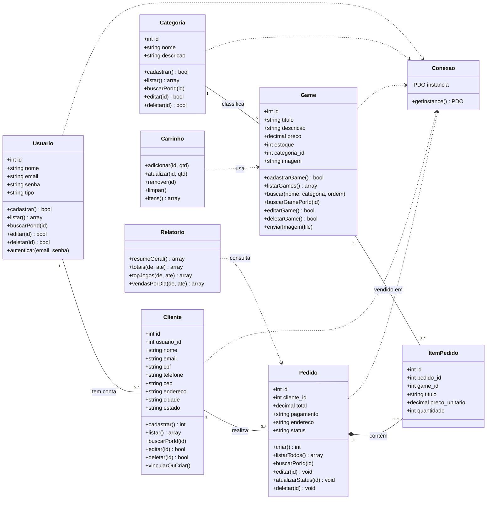
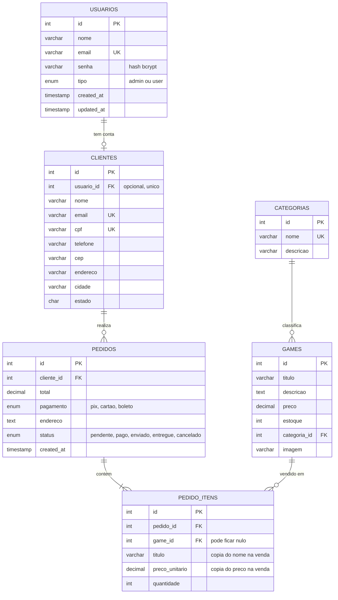

# 🎮 GameStock — Loja de Jogos

Sistema web de loja virtual de jogos, com **vitrine pública para clientes** e **área administrativa** protegida por login.
Desenvolvido em **PHP 8 + MySQL (PDO)**, com **Programação Orientada a Objetos** e **arquitetura MVC**.

## Integrantes

| Nome | Matrícula |
|---|---|
| **[PREENCHER: nome do integrante 1]** | [PREENCHER] |
| **[PREENCHER: nome do integrante 2]** | [PREENCHER] |

## Link do repositório

**[PREENCHER: https://github.com/SEU-USUARIO/NOME-DO-REPOSITORIO]**

---

## Tema da loja

Loja de **jogos (games)** — venda de jogos para diversos estilos (aventura, ação, esporte, RPG, indie...), com controle de estoque.

## Descrição do sistema

O **GameStock** permite que qualquer visitante conheça a loja e navegue pelos jogos cadastrados. Para comprar, o cliente
cria uma conta (nome, e-mail, telefone e senha), adiciona jogos ao carrinho, informa o endereço e a forma de pagamento
(simulada) e acompanha seus pedidos.

O administrador entra por login e gerencia tudo: jogos, categorias, clientes, usuários e pedidos, além de ver um
dashboard com os números da loja e um relatório de vendas por período.

## Tecnologias utilizadas

- **PHP 8** (POO, PDO, sessões) · **MySQL / MariaDB** (banco relacional, chaves estrangeiras)
- **HTML5 + CSS3** (layout responsivo, tema escuro) · **JavaScript** puro (validação, máscaras, modais, carrinho de linhas)
- **XAMPP** (Apache + MySQL) como ambiente de execução · **Git/GitHub** para versionamento

## Arquitetura MVC

```
loja_games/
├── index.php                      → página inicial pública (redireciona para a vitrine)
├── login.php                      → tela de login (View)
├── database.sql                   → script completo do banco + dados de teste
├── admin/                         → área administrativa
│   ├── config/conexao.php         → classe Conexao (PDO), sessão e funções auxiliares
│   ├── models/                    → MODELS (classes POO que falam com o banco)
│   │   ├── usuarios.php  clientes.php  games.php  categorias.php  pedidos.php
│   │   └── relatorios.php         → consultas do dashboard e relatório
│   ├── views/                     → VIEWS (só HTML + exibição de dados)
│   │   ├── dashboard.php  relatorio_vendas.php
│   │   └── ver_/cadastrar_/editar_ de cada entidade
│   ├── controllers/               → CONTROLLERS (recebem o POST, validam, chamam o Model, redirecionam)
│   │   ├── autenticar.php  logout.php
│   │   ├── salvar_*.php           → criar/editar (usuario, cliente, game, categoria, pedido)
│   │   ├── deletar_*.php          → excluir
│   │   └── exportar_vendas.php    → CSV
│   └── public/ (css, js, imagens) → arquivos estáticos
└── loja/                          → área do cliente (mesma divisão M-V-C)
    ├── models/carrinho.php        → carrinho de compras (sessão)
    ├── views/                     → loja, jogo, carrinho, checkout, cadastro, minha_conta, meus_pedidos...
    └── controllers/               → carrinho, finalizar_compra, registrar_cliente, salvar_conta, cancelar_pedido
```

**Fluxo:** a *View* mostra o formulário → o formulário envia o POST para um *Controller* → o Controller valida e usa o *Model* →
o Model executa SQL via PDO → o Controller redireciona de volta (com mensagem) para uma *View*.

---

## Diagrama de classes (UML)

> Os diagramas abaixo são exibidos automaticamente pelo GitHub (Mermaid). Para exportar como imagem, cole o código em https://mermaid.live.



> `ItemPedido` corresponde à tabela `pedido_itens` e é gravado/lido pela classe `Pedido`.

## Modelo do banco de dados (relacional)



O script **`database.sql`** cria o banco, as 6 tabelas (com chaves primárias e estrangeiras) e os dados iniciais de teste.

---

## Regras de negócio

1. Qualquer visitante pode ver a vitrine, buscar, filtrar por categoria e abrir os detalhes de um jogo; **comprar exige login**.
2. Todo cliente que cria conta pela loja vira **usuário do tipo `user`** e ganha um **cadastro de cliente**. Ninguém vira administrador pelo cadastro público.
3. O e-mail é único (em usuários e em clientes) e o CPF, quando informado, é validado e único.
4. Senhas são guardadas **somente** com `password_hash()` e conferidas com `password_verify()`.
5. Apenas usuários **`admin`** acessam a área administrativa; clientes logados são redirecionados para a loja.
6. Um jogo só pode ser colocado no carrinho se houver estoque; a quantidade nunca passa do estoque.
7. **Criar um pedido baixa o estoque**; **cancelar ou excluir** um pedido não cancelado **devolve** os jogos ao estoque (tudo em transação: ou grava tudo, ou nada).
8. Pedido cancelado não pode ser reaberto nem editado. O cliente só cancela pedidos **pendentes**.
9. O pedido guarda o **título e o preço do jogo na hora da compra**; mudar o preço ou excluir o jogo depois não altera o histórico.
10. **Categoria com jogos** e **cliente com pedidos** não podem ser excluídos.
11. Um administrador não pode excluir a si mesmo, remover o próprio acesso nem o **último administrador**.
12. Relatórios e faturamento **não contam pedidos cancelados**.

## Funcionalidades implementadas

**Requisitos mínimos**
- ✅ Página inicial pública (apresentação da loja, informações para o cliente, jogos vindos do banco)
- ✅ Registro de cliente pela interface (nome, e-mail, telefone, senha)
- ✅ Login, logout e proteção da área administrativa (sessão + `password_hash`)
- ✅ Área administrativa com **CRUD completo de 5 classes**

| Classe | Criar | Listar | Editar | Excluir |
|---|---|---|---|---|
| **Usuario** | `cadastrar_usuario` | `ver_usuarios` | `editar_usuario` | `deletar_usuario` |
| **Cliente** | `cadastrar_cliente` / cadastro da loja | `ver_clientes` | `editar_cliente` / Minha conta | `deletar_cliente` |
| **Game (produto)** | `cadastrar_game` | `gerenciar_games`, `ver_games` | `editar_game` | `deletar_game` |
| **Categoria** | `cadastrar_categoria` | `ver_categorias` | `editar_categoria` | `deletar_categoria` |
| **Pedido** | `cadastrar_pedido` / checkout | `ver_pedidos` | `editar_pedido` | `deletar_pedido` |

**Funcionalidades extras (o enunciado pede no mínimo 3 — foram feitas 9)**
1. 🔍 **Busca** de produtos por nome (e de clientes, usuários, categorias)
2. 🏷️ **Filtro por categoria** e ordenação (nome, preço, lançamentos)
3. 🖼️ **Upload de imagem** do jogo (valida tipo e tamanho, com pré-visualização)
4. 🛒 **Carrinho de compras** + checkout + "Comprar agora"
5. 📦 **Controle de estoque** (baixa na venda, devolução no cancelamento, alerta de estoque baixo)
6. 📄 **Página de detalhes** do produto
7. 📊 **Dashboard administrativo** (faturamento, pedidos, vendas dos últimos 7 dias, mais vendidos, estoque baixo)
8. 🧾 **Relatório de vendas** por período (por dia, jogo, categoria e pagamento) com **impressão** e **exportação CSV**
9. ✅ **Validação de formulários com JavaScript** (campos obrigatórios, e-mail, senha, máscaras e validação de CPF/telefone/CEP)

**Segurança**
- Consultas com **PDO e prepared statements** (contra SQL Injection) · saída escapada com `htmlspecialchars` (contra XSS)
- **Token CSRF** em todos os formulários POST · exclusões somente por POST
- Sessão com cookie `HttpOnly` + `SameSite`, `session_regenerate_id` no login e **bloqueio de 60 s após 5 senhas erradas**

---

## Instruções para instalar e executar

**Pré-requisitos:** [XAMPP](https://www.apachefriends.org) com **PHP 8.0 ou superior** e MySQL/MariaDB.

1. Copie a pasta do projeto para `C:\xampp\htdocs\crud2022\loja_games`
   (se usar outro caminho, o sistema funciona igual — todos os links são relativos).
2. Abra o **XAMPP Control Panel** e inicie **Apache** e **MySQL**.
3. Acesse `http://localhost/phpmyadmin` → aba **Importar** → escolha o arquivo **`database.sql`** → **Importar**.
   > ⚠️ O script **apaga e recria** o banco `loja_games`.
4. Se o seu MySQL tiver senha, ajuste as constantes no início da classe `Conexao` em `admin/config/conexao.php`.
5. Abra no navegador: **`http://localhost/crud2022/loja_games/`**

## Usuário e senha de teste

| Perfil | E-mail | Senha | O que acessa |
|---|---|---|---|
| **Administrador** | `evandro@gmail.com` | `admin123` | Painel administrativo (`/admin`) |
| **Cliente** | `pedro@gmail.com` | `user123` | Loja, carrinho, meus pedidos |

Também é possível criar uma conta nova em **Criar conta** (sempre como cliente).

## Prints das principais telas

> Os arquivos ficam em `docs/prints/` (veja `docs/prints/LEIA-ME.txt` com o nome de cada print).

| | |
|---|---|
| **Página inicial**  | **Detalhe do jogo**  |
| **Carrinho**  | **Checkout**  |
| **Registro de cliente**  | **Login**  |
| **Dashboard**  | **CRUD de jogos**  |
| **Categorias**  | **Clientes**  |
| **Usuários**  | **Pedidos**  |
| **Relatório de vendas**  | **Meus pedidos (cliente)**  |

## Checklist dos requisitos do enunciado

| Requisito | Onde está |
|---|---|
| PHP 8, MySQL, PDO | `admin/config/conexao.php` (classe `Conexao`) |
| POO | Models em `admin/models/` (classes com atributos e métodos) |
| MVC (Models, Views, Controllers) | pastas `models/`, `views/`, `controllers/` em `admin/` e `loja/` |
| Banco relacional | `database.sql` (6 tabelas, PK e FK) |
| Autenticação e sessão | `login.php`, `autenticar.php`, `logout.php`, `exigir_login()` |
| `password_hash()` | `Usuario::cadastrar/editar` e hashes bcrypt no `database.sql` |
| Página inicial pública | `loja/views/loja.php` |
| Registro de cliente | `loja/views/cadastro.php` + `registrar_cliente.php` |
| Área admin protegida | `exigir_login()` em todas as telas/controllers de `admin/` |
| 5 classes com CRUD | Usuario, Cliente, Game, Categoria, Pedido (tabela acima) |
| 3+ funcionalidades extras | 9 listadas acima |
| Diagrama de classes e modelo do banco | seções acima |
| Repositório público no GitHub | `docs/PUBLICAR_NO_GITHUB.md` |
"# gamestock-loja-de-jogos" 
